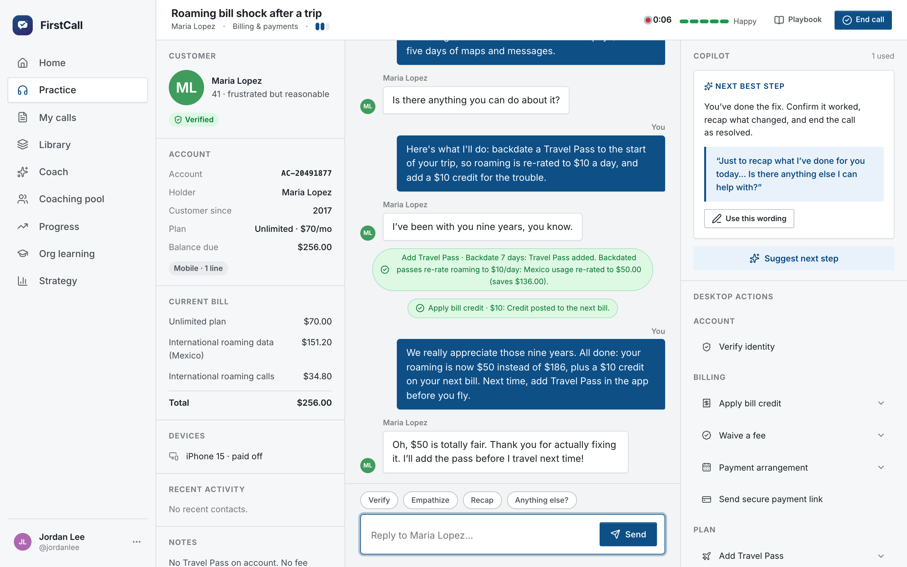

# FirstCall

**From "train the agents" to a business case for resolving calls the first time**

**[Read the case study →](https://github.com/CB-viberrr/portfolio/blob/main/case-studies/firstcall.md)** · [Live demo (one click, no sign-up)](https://firstcall-psi.vercel.app)

- Diagnosed why calls get transferred.
- Matched each root cause to the right lever, and sized it in dollars.
- Built a business case that answers "based on what?".
- Designed how to prove it.

---
This repository is a showcase: the code is private. A walkthrough or read access is available on request.
More work: [portfolio](https://github.com/CB-viberrr/portfolio) · © 2026 Charles Bingaman
